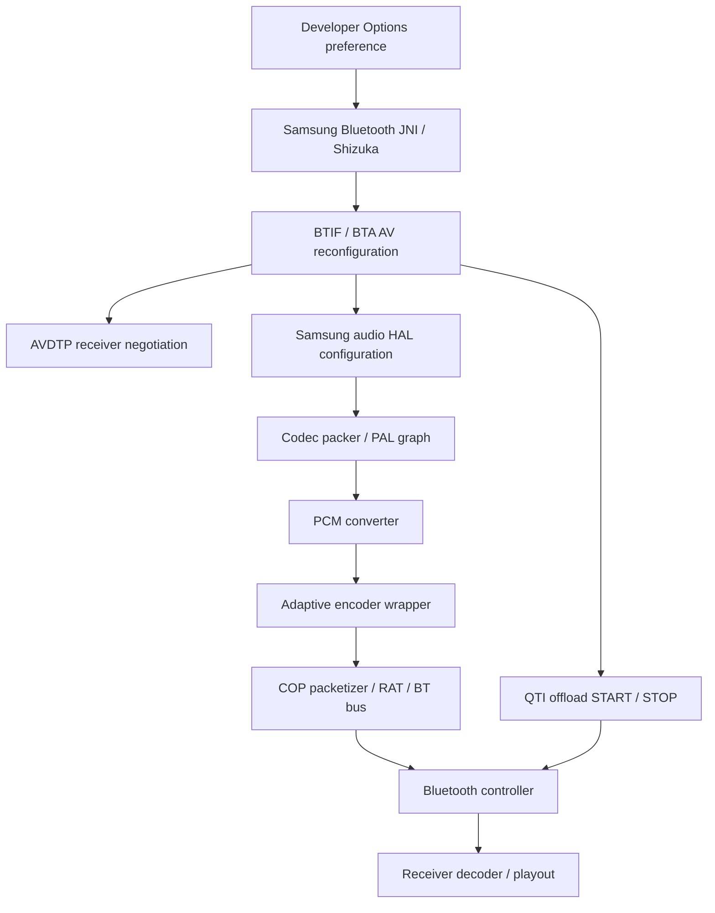

# Adaptive pipeline investigation

Static inspection applies to the supported Samsung firmware and its exact binary inputs. It establishes code paths, not audible correctness or receiver buffer occupancy. The 44.1 kHz click and intermittent rate-change silence remain unresolved.



## Configuration is not an applied-state acknowledgement

Settings refreshes its store from the current codec status, changes a field, submits a preference, and updates the dialog optimistically. The native request queues asynchronous reconfiguration. Shizuka's desired state, the locally selected codec descriptor, the HAL graph and the controller session can therefore represent different stages of the same change.

Samsung's same-codec path intentionally returns an outer `restart_output=false` even when the local setter requested a restart. Actual reconfiguration is deferred through `start_session_delayed → SetCodecDeviceReconfig`. Codec reselection is a different operation: Settings resets rate/format preferences to the highest selectable values. Its ability to restore sound does not identify which deferred stage stalled.

A successful recorded 96→44.1→48 kHz transition unloaded R3, initialized the legacy encoder at 48 kHz and received successful controller responses. Android published the 48 kHz selection roughly one second before the logged DSP initialization. That successful case does not explain the user's intermittent silence.

Software A2DP transmit flags and software-queue flush errors are not sufficient failure evidence on hardware offload: Samsung bypasses those software paths. Likewise, the stock close routine can log a missing acknowledgement on an out-of-state fast path without waiting for one. A failed transition must be captured with the prior session state and actual graph/controller lifecycle preserved.

## Sample rate and PCM format

The wrapper selects R3 for the Adaptive revision-3 / 44.1 kHz combination. The inspected 48/96 kHz paths use the legacy encoder. R3's input conversion shifts interleaved 32-bit PCM containers into channel buffers; that operation changes precision/layout, not sample rate. Raw PCM and analysis-band remainders are retained separately.

PAL distinguishes codec rate from the COP/hardware bus rate: 44.1→88.2 kHz and 48→96 kHz bus configuration are intentional, while the encoder still receives 44.1/48 kHz. A doubled bus rate does not enable an 88.2 kHz codec selection.

The encoder emits COP metadata for PCM frame length (`0x0A001037`), PCM format (`0x0A001038`) and zero padding (`0x0A001039`). R3 passes a nominal per-channel sample target as frame-length metadata. Actual core consumption and encoded represented samples still need to be reconciled with that target; neither buffer alignment nor a nominal interval proves a sample loss. For a nominal 1323-sample target, direct and eight-band paths use different aligned lower/upper thresholds. Analysis data and entropy bytes can carry into later chunks/output buffers. A simple claim that every output contains 1320 samples while advertising 1323 is unsupported.

## What the latency fields actually do

The inspected legacy and R3 INIT handlers accept `minHQ`, but do not read the incoming `maxHQ`. Their PROFILE handlers acknowledge the parameter as deprecated without applying the supplied TTP fields. Thus a successful parameter call does not establish that the receiver's profile values took effect.

For HQ state 3, the inspected intermediate timing calculation is:

```text
candidate_us = profile_target * 4000 - (period_ms + 1) * 1000
               - 62000 - pending_pcm_duration_us
lower_us = minHQ * 1000 + 10000
upper_us = internal_maxHQ * 4000 + 10000
adjustment = clamp(candidate_us, lower_us, upper_us)
```

The initialized target is 70. With no pending PCM, 30/20 ms periods give 187/197 ms components. A separate state-machine term can add 0/6 ms afterwards. Other conditional minimums and a legacy output-path addition can also apply. The returned header field is 16-bit in 8 µs units. These are scheduling adjustments, not measured receiver occupancy or allocated buffer sizes.

The current Lossless request retains HQ bounds 60/100. `minHQ=60` produces a 70 ms lower bound, below those observed candidates; the incoming maximum is ignored. Samsung also sign-extends the source's buffering bytes, so simply increasing a byte above 127 can reset the DSP minimum to its default rather than increase it. These fields are not a demonstrated stability control.

R3 also acknowledges the legacy bitrate-level and level-map APIs as not implemented. Its implemented IMCL controller-feedback path changes quality/ENCLEVEL; forcing that feedback is not a verified method to increase headroom. No safe, effective public control for enlarging the receiver's buffer has been established.

The wrapper requests disabling the framework's one-time prebuffer during its initial legacy initialization. Public AudioReach code maps this to inter-container buffering, with separate regular/prebuffer decisions. It is distinct from receiver playout buffering. Later switch to R3 and the stock framework's effective graph state require runtime validation. R3 at 44.1 kHz also requests COP zero padding off; HQ at 48 kHz can request it on. The closed packetizer's interpretation has not been established, so neither flag is patched speculatively.

## Remaining unobserved boundary

Completed encoder output is not final over-air delivery. Its proprietary eight-byte header is not established as an RTP header. The padded output container size, HAL bitrate and encoder target bitrate are not measured codec/radio throughput.

An offline observer has been built to inspect completed output from both encoder backends. It has not been deployed or validated for loader acceptance, runtime ABI or logging overhead. Output timestamps may still precede framework propagation; validity flags must be checked. Capturing exact per-core consumption and downstream scheduling remains necessary before changing timing or buffering behavior.

For an intermittent silent transition, preserve the first failure before reconnecting or selecting the codec again:

| Last confirmed milestone | Next boundary to examine |
| --- | --- |
| Settings selection only | Java/native preference submission |
| Local configuration changed | Deferred device reconfiguration / AVDTP |
| AVDTP reconfiguration accepted | Provider/PAL restart trigger |
| AVDTP START and PAL success | Controller offload START completion |
| Controller completion succeeded | New DSP format, source PCM and graph generation |
| Correct PCM reaches encoder | Completed encoded output and sample accounting |
| Completed encoded output continues | COP/controller delivery, encoded content and receiver playout |

The previous transition log filter selected literal `PAL`, missing tags such as `PAL: Bluetooth`; graph call ordering cannot be inferred from those missing lines. Reading existing logs and filtering tag prefixes on the host avoids changing runtime logging settings.

Public interface references: [AudioReach metadata](https://github.com/AudioReach/audioreach-engine/blob/5773bf8e627c9857481dd338a9ec4aea4a49afd3/fwk/spf/interfaces/module/metadata/api/bt_metadata.h), [Bluetooth framework extension](https://github.com/AudioReach/audioreach-engine/blob/5773bf8e627c9857481dd338a9ec4aea4a49afd3/fwk/spf/interfaces/module/capi/capi_fwk_extns_bt_codec.h), [codec packer](https://github.com/AudioReach/audioreach-pal/blob/f998d7b63181d59410aea4d3d79014751a24b391/plugins/codecs/bt_aptx.c). Their presence in public source does not prove identical firmware behavior.
